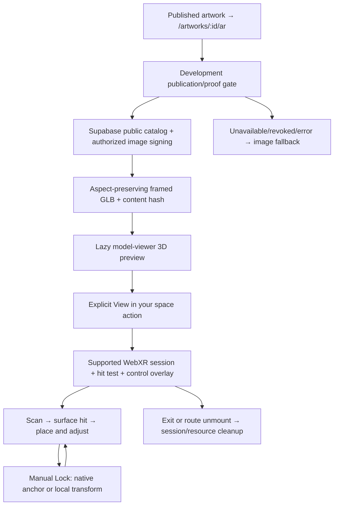
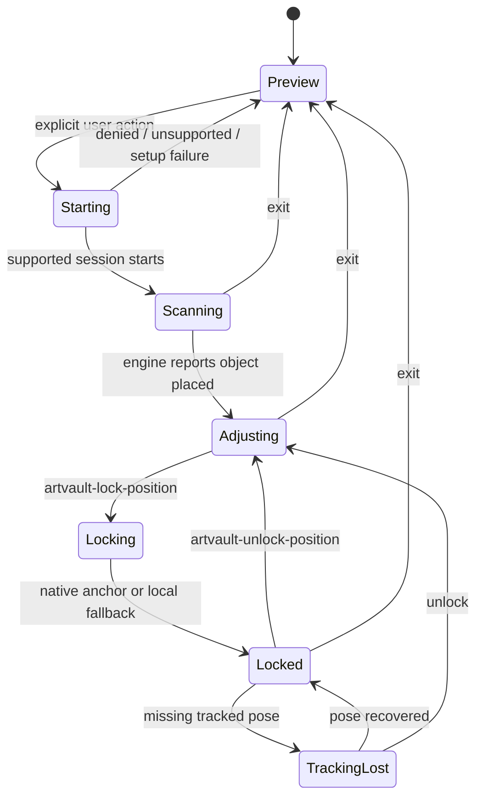

# ArtVault AR Gallery — implementation and demonstration guide

Status: local repairs and automated verification, not production deployment.
The owner previously reported physically working Android placement/Lock/Unlock.
No physical device was attached for this 2026-10-24 continuation, so repaired
behavior still needs the physical checklist below. No camera session was opened
by automated tests and no hosted Supabase changes were made.

## Architecture and scope

| File | Responsibility |
| --- | --- |
| `src/app/routes/ArtworkArPage.tsx` | Existing artwork-specific route, public artwork query, navigation and image fallback |
| `src/features/ar/components/DevelopmentArProof.tsx` | Development flag, matching manifest/image, publication gate, periodic/focus refresh and abort on unmount |
| `src/features/ar/components/ArtworkArViewer.tsx` | Active shared 3D/AR viewer, four frames, estimated-size controls, loading/errors and WebXR DOM controls |
| `src/features/ar/loadViewer.ts` | Lazy pinned model-viewer integration; optional native anchor/local lock; owned-session cleanup |
| `src/features/ar/proof.ts` | Versioned same-origin manifest validation, frame variants and dimension consistency |
| `src/features/ar/webxrMath.ts` | Tested dimension/scale helpers used by the alternative viewer |
| `scripts/lib/arProof.mjs` | Supabase public-source authorization, bounded image loading, GLB generation, hashes and development delivery |
| `scripts/prepare-ar-proof.mjs` | Existing optional operator preparation command; models also generate lazily |

`ArtworkWebXrViewer.tsx` contains an alternative Three.js/GLTFLoader implementation.
It is not imported by the active route. It was preserved, not substituted for the
physically working engine. Its presence is not evidence of a second tested AR
runtime. The active model-viewer itself uses Three.js internally.

The source contains no artwork-specific hardcoding. Black, Walnut, White and
Gold models use the selected artwork image. The current proof is gated by Vite
development mode and `VITE_ENABLE_DEVELOPMENT_AR_PROOF`; it intentionally does
not ship local proof endpoints/assets in a production build. Production HTTPS
asset generation/delivery is a separate deployment task, not completed here.

## Model generation and asset security

The existing generator queries `artwork_catalog` using only browser-safe project
configuration and the publishable key. It never requires a service-role key.
Publication/RLS and Storage signing authorization remain authoritative. It
validates seller/artwork/image path association, allowed MIME, input dimensions
and decoded bytes. Signed source URLs are not returned in the proof manifest.

The image is orientation-normalized, aspect-preserving and embedded in the GLB.
Texture edges are capped at 2,000 pixels, source downloads at 10 MiB, generated
models at 5 MiB, with bounded retries/timeouts. The frame is a visualization:
30 mm width, 12 mm depth and a small front offset to avoid z-fighting. Geometry
uses metres; metadata/UI use millimetres/centimetres. Double-sided artwork
materials and backing/frame geometry are already verified by script tests.

Each artwork/frame has a SHA-256 version. The middleware allows only GET/HEAD,
matches the artwork/version, rechecks publication/source bytes, verifies cached
model hashes and sends `no-store`/`nosniff`. Raw generated directories, stale or
corrupt versions and unrelated image paths are denied. Existing private bucket
policies were not changed. A missing/expired signed image is re-signed by the
existing source loader; errors fail closed instead of using a public bucket.

The client refreshes manifests every 15 seconds and on focus, without overlapping
requests. It aborts on unmount and restores the image fallback if access is
revoked. Network checks cannot erase bytes already downloaded to a device, and
offline revocation cannot be instantaneous. Do not claim otherwise. No signed
URLs, credentials or raw provider errors are added to application logs.

## Placement, lock and size

WebXR hit tests provide surface poses; model-viewer owns scanning, its placement
indicator/reticle, initial placement and supported native repositioning. This is
not semantic room reconstruction, guaranteed plane classification, camera-based
measurement or a claim that light estimation is available. Optional browser
features are used only if the runtime provides them.

The integration remains pinned to model-viewer **4.3.1** because it uses an
internal renderer seam. Do not upgrade it without rerunning these tests and
physical Android checks. No node_modules files were modified.

Lock is manual; optional native anchoring is not the editing lock. When locked
(including pending lock, tracking loss or recovery), all size controls are
disabled and their handlers reject synthetic/stale changes. Native translation,
rotation and gesture flags are cleared; transient touch hit testing is cancelled.
The saved transform is enforced around engine frame processing. Tracking loss
holds the last known transform instead of selecting another surface.

Unlock deletes any native anchor and restores transient input when supported.
Generation tokens discard late anchor results from an earlier lock/session,
including Unlock → Lock races. Session-end and visibility events clear stale
interaction state. Event handlers belong to the presenting element, so an old
viewer cannot unlock a different artwork. Release removes handlers, cancels
owned presentation, and also stops an activation that completes after unmount.

Sizing: `display_mm = base_mm × scale_percent / 100`, then `display_cm = mm / 10`.
The active viewer rounds to 5% steps and clamps to **35–300%**, resetting to 100%.
The helper convention is the equivalent **0.35–3.0** multiplier. Model and
readout stay synchronized. Native pinch scaling is intentionally fixed; unlocked
size changes use ArtVault's slider/minus/reset/plus controls. Other native
gestures depend on model-viewer/device support. No new rotation UI was invented.
All displayed dimensions remain **estimated**, never camera-measured or verified
seller measurements. Lock is session-local, not persistent cross-session mapping.

## Error handling and Android requirements

The 3D preview is useful without camera AR. Loading failure retains the artwork
image and retry action; failed loader cache entries are evicted so retry fetches
again. No camera is requested during initial render. Duplicate launch clicks are
blocked, with a visible Starting AR state. Denied permission, unsupported session,
insecure context and generic failure have safe messages, without raw URLs/errors.
Failed graphics setup ends the acquired XR session instead of leaving it open.

Android Chrome needs a compatible WebXR/ARCore device, current supported AR
services, permission and a secure context. Compatibility is detected by the
browser/viewer, not an Android user-agent guess. The in-browser controlled path
requires hit testing and, when an overlay is provided, DOM overlay support.
Native anchors and light estimation remain optional; no availability is promised.
Scene Viewer is the existing fallback mode, but an external native viewer owns
its UI and cannot display ArtVault's custom Lock/size controls. iOS Quick Look
is not enabled. Unsupported devices retain the 3D/image fallback.

References: [WebXR session requirements](https://developer.mozilla.org/en-US/docs/Web/API/XRSystem/requestSession),
[model-viewer AR examples](https://modelviewer.dev/examples/augmentedreality/),
[Supabase private asset delivery](https://supabase.com/docs/guides/storage/serving/downloads).

## Physical Android demonstration checklist

No physical tests in this continuation: ADB reported **0 authorized devices**.
Use the OnePlus 8T if available, and another supported Android device later.

1. Start the existing local Vite server on 5173, ensure the development AR flag
   is enabled locally, and use a genuinely PUBLISHED artwork. Do not change
   hosted records simply to demonstrate this module.
2. For the existing trusted USB development workflow, authorize the phone's USB
   debugging prompt, run `adb reverse tcp:5173 tcp:5173`, then open
   `http://localhost:5173/artworks/<published-artwork-id>/ar` in phone Chrome.
   A PC LAN HTTP address is not equivalent to a secure context. Alternatively
   use a separately approved HTTPS deployment. Do not bypass browser security
   or create a public tunnel for this test.
3. Confirm the correct artwork, all four frame variants, aspect ratio and
   **estimated** dimensions. Test portrait, landscape and near-square listings.
4. Tap View in your space once; allow permission. Verify scanning guidance,
   real surface indicator/reticle and placement on a well-lit textured wall.
   Surface detection is a physical test, not established by mocked events.
   Check that this is Chrome WebXR with ArtVault's controls visible. A separate
   Scene Viewer app is the native fallback and does not verify custom Lock/Unlock.
5. Reposition using supported native gestures. Use minus/reset/plus and slider,
   including 35% and 300% limits. Check model/readout agreement.
6. Lock; try dragging, multi-touch/pinch, size controls and accidental touches.
   Placement/size must remain unchanged. Verify both native-anchor and local
   fallback status when those environments can be exercised.
7. Unlock, move and resize, then relock repeatedly. Do not claim world tracking
   is perfectly stable or that this creates a permanent saved anchor.
8. Briefly obscure tracking, background/restore Chrome, rotate the phone and
   interrupt/resume the session. Check the last placement holds, status is clear,
   and Unlock remains usable after recovery. Do not test while walking unsafely.
9. Exit/re-enter repeatedly; use browser Back during preview/session startup
   and active AR. Confirm the camera indicator/session stops and subsequent
   placement begins unlocked. Check no duplicate gestures or controls appear.
10. Test permission denial, unsupported device, slow/offline network and failed
    model load. Verify the image/3D fallback and retry; never expose draft assets.
11. Record device/Android/Chrome/AR-services versions, model size, observed load
    time and results. FPS, thermal behavior and physical tracking accuracy are
    **unverified** until measured on hardware.

## Verification and preservation

Tests mock WebXR/model-viewer boundaries and use existing isolated SQL fixtures.
No test opens a real camera, uses a real payment, or writes hosted Supabase.
Coverage includes explicit/denied startup, feature requirements, engine hit-test
delegation, placement events, local/native locks, stale anchors, tracking loss,
visibility/session end, pending activation cleanup, control ownership, repeated
mounts, size bounds, model failure and publication/version revocation.

Run the full frontend suite, focused `src/features/ar/` plus ArtworkArPage,
`test:supabase`, `test:payments`, `test:scripts`, typecheck, lint, production build
and `git diff --check`.
Scripts retain generation/geometry/UV/hash/security tests. Mocked hit-test and
session events verify integration contracts, not actual camera plane detection.

Final local results, 2026-10-24:

| Check | Result |
| --- | --- |
| Focused AR + artwork AR route | 72 passed, 7 files |
| Full frontend regression | 1,713 passed, 179 files |
| PostgreSQL/RLS (isolated PGlite) | 158 passed |
| Razorpay TEST handler tests | 36 passed |
| Scripts/AR/provider contracts | 46 passed, 3 files |
| TypeScript | PASS |
| Lint | PASS — 0 errors, 66 existing warnings; no added warnings |
| Production Vite build | PASS — 5.33 seconds |
| Git diff check | PASS |

All final test suites have zero failures/skips/cancellations. This adds 29 frontend
regressions without deleting existing coverage. Existing jsdom `scrollTo` notices
remain. The build emitted a non-failing Rolldown/Tailwind plugin-timing advisory
(2.7 seconds in the Tailwind transform); it is separate from lint warnings and
does not establish a phone performance problem. No dependencies, migrations,
hosted configuration/data, payment operations, commits or pushes were introduced.

The new verified snapshot contains 550 source files at
`../artvault-source-backups/ar-finalization-20261024-101321`, outside the repo.
It supersedes the older snapshot for this continuation and excludes credentials,
dependencies/build outputs and browser/emulator data. The three pending
Module 05/06/assistant migrations remain unchanged. No Auth, checkout, payment,
auction, AI or recommendation behavior is modified. No dependencies were added.

Files in this continuation: `src/features/ar/loadViewer.ts`, new
`src/features/ar/loadViewer.lifecycle.test.ts`,
`src/features/ar/components/ArtworkArViewer.tsx` and its existing test file,
this guide, the historical-guide banners and `ARTVAULT_PROJECT_STATE.md`.

## Known limitations

- The repaired build needs physical Android regression testing; previous owner
  success does not prove the newest repair on real hardware.
- Production AR asset service/HTTPS delivery is still not implemented/deployed.
  Local proof flags/endpoints are intentional development infrastructure.
- Native anchor/tracking quality varies by device; local lock is a fallback,
  not a persistent world map or a guarantee against ARCore drift.
- No guaranteed plane semantics, light estimation, iOS Quick Look, capture,
  cross-session placement persistence or newly invented rotation controls.
- Source revalidation has bandwidth/latency cost; proof generation is bounded
  and cached, but current source bytes are rechecked for authorization/versioning.
- Browser/model-viewer own low-level WebGL disposal and hit-test resources;
  the custom adapter closes only its owned session and does not terminate
  another artwork's renderer.

Hosted changes: NONE. Git commit/push: NONE.
