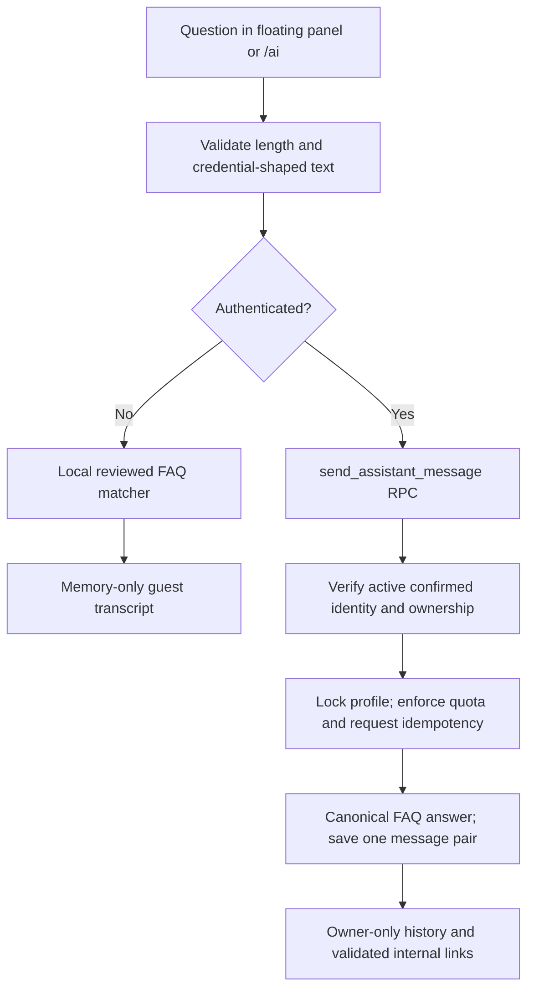

# ArtVault assistant and artwork recommendations

## Scope and audit

The previous `/ai` page and floating launcher were UI shells with disabled
Send/New Chat actions. Conversations/messages already existed in PostgreSQL,
but no trusted response operation or history client was connected. The launcher
was hidden on short screens. Recommendations used wishlist categories and a
like-count list; working follow/like features were incorrectly marked unavailable.

This continuation reuses AppShell, the existing Auth provider, Modal/Drawer,
marketplace cards, catalog mapping, private image signing, existing AI tables,
likes, wishlists, follows and inventory. It preserves pending Modules 05/06,
authentication, payments, fulfillment and the working AR viewer.

## Assistant flow



`AssistantProvider` is mounted once inside AppShell, without remounting the
application on login/logout. It clears/masks previous-account conversation state
and ignores late requests when identity changes. Minimize retains the current
draft; New Chat starts a separate conversation. Transcript, loading indicator,
retry/discard actions and keyboard submission are shared by both interfaces.
The mobile launcher respects safe areas and bottom navigation. Modal/Drawer
reuse the existing focus/keyboard behavior. React renders response text as text,
never HTML, Markdown HTML, scripts or externally supplied navigation.

The FAQ covers registration, artists, discovery, cart, addresses, checkout,
orders, Razorpay TEST payments, auctions, seller workflow, analysis and Android
AR. It explicitly says it cannot retrieve or change live account/payment state.
Customer-specific questions link to existing authenticated owner-only pages.
It does not fabricate delivery, inventory, bid or payment information.

### Provider distinction

**Current runtime: local rule-based FAQ, not generative/visual AI.**
`src/features/ai/faq.json` contains the reviewed knowledge. Browser matching and
the migration seed are checked for parity in SQL tests. Longest whole-keyword
match wins; canonical priority breaks ties. Unknown questions receive an honest
general response. No API key or new package is required.

`scripts/lib/assistant-provider.mjs` is an optional **server-only** intent
classifier contract. A future adapter may return only `{ topic }` from an
allowlisted enum. Strict validation rejects extra fields, tools, links or
free-form claims. Timeout is bounded to 10 seconds, retry to one; invalid/
unavailable providers fall back to FAQ without logging raw errors. Tests use
injected mocks, not real model calls. This contract is not a deployed provider
or Edge Function. Adding one needs a separately reviewed trusted integration,
secret management, cost approval and deployment.

### Privacy and reliability

- Existing `public.ai_conversations` and `public.ai_messages` are reused.
  Message `method` and `links` columns distinguish FAQ/model/legacy data.
- Only verified ACTIVE users can persist/read their own conversations. SYSTEM
  messages are hidden even from owners. Anonymous RPC execution is denied.
- Direct conversation/message creation is revoked from browser roles. Trusted
  RPCs derive identity from `auth.uid()`, never a frontend user ID/role.
- `private.support_faq` is canonical knowledge, not client-editable content.
  `private.assistant_requests` stores request hashes/IDs and message references.
  Both use RLS and have no browser grants.
- One caller profile lock serializes message sequencing, quota and idempotency.
  Maximum question length: 1,000 characters; 10 requests/minute, 200/day;
  200 messages/conversation. History: latest 20 conversations, latest 100
  messages when opening one. Guest limit: 10/minute, 100 in-memory messages.
- Retry uses the same UUID/body/conversation, returning the original exchange.
  Changed-body reuse is denied. Quota metadata survives conversation deletion;
  deletion cannot reset limits. Metadata is retained for replay safety; a future
  retention policy must explicitly define the accepted replay horizon.
- Chat is not stored in localStorage/sessionStorage. Existing Supabase Auth
  session management remains unchanged. Prompts/passwords/OTPs are never added
  to profile tables. Credential-shaped input is rejected, but redaction is not
  a substitute for the visible instruction never to submit secrets.
- No assistant RPC can execute order, payment, stock, auction or role mutations.
  Prompt injection can only select a reviewed answer, never authorize actions.

## Customer recommendation architecture

`get_artwork_recommendations` is one bounded read-only RPC for six modes:
For You, Similar Artworks, Trending Now, Artists You Follow, Based on Your Likes,
and New Discoveries. Identity is resolved server-side; caller-supplied user IDs
are not accepted. Guest discovery uses public signals and, when available, one
actual locally saved public artwork as a similarity anchor.

Eligibility requires PUBLISHED status, approved ACTIVE seller, valid INR price,
positive available inventory and an existing supported Storage image with a
source hash. Draft/rejected/suspended listings and missing/sold/reserved assets
are excluded. The catalog mapper signs private assets as before; signing failures
are skipped rather than replaced with fake images. Related findings can use
category/tags and only successful VISION style metadata matching the image hash.
Titles alone never imply visual analysis.

Only the caller's own likes/wishlist/follows shape private preferences. Engagement
uses distinct ACTIVE user IDs across likes and wishlists, counting one person
once per artwork and excluding seller self-interactions. No interaction IDs,
emails, private wishlists, orders or auction winner/order UUIDs are returned.
Visible reasons describe evidence, such as “Based on your wishlist”, “Similar
category”, “From an artist you follow” or “Real marketplace engagement”.

### Ranking and limitations

Let `e = unique_engagement / (unique_engagement + 5)` and
`f = max(0, 1 - age_days / 60)`. Inputs are bounded, scores are rounded to three
decimals. Weights are transparent discovery signals, not artistic-quality scores.

| Mode | Score components (maximum 100) |
| --- | --- |
| For You | 15e + 15f + 25 wishlist category + 20 liked category + 15 follow + 10 tags |
| Related/guest anchor | 15e + 15f + 40 category + 15 tags + 15 supported style |
| Following | 15e + 15f + 70 follow |
| Based on Likes | 15e + 15f + 65 liked category + 5 tags |
| Trending | 80e + 20f |
| New | 100f |

Seller round-robin diversification runs before the final score/date/UUID ordering,
so each eligible seller gets exposure before another round. Freshness gives new
listings a signal even without likes. The candidate pool is bounded to the newest
500 eligible listings; this is intentionally a college-project scale bound, not
an unlimited catalog search. Empty interest sets fall back to honest public
discovery rather than invented personal preferences. Already saved/liked works
are excluded from personal/related/liked discovery, but remain in public trending.

Pages contain 12 records (server maximum 20); offset is bounded below 500.
The cursor preserves an `asOf` cutoff, with stable ordering for the same inputs.
Stock, moderation and engagement remain current: this is not a persisted
immutable recommendation snapshot. Concurrent input changes can reorder pages;
the frontend removes duplicates. New catalog scale would require a dedicated
snapshot/keyset design. Results/cache keys are partitioned by Auth identity and
removed on identity change; no previous-user personalized results are reused.

**Module 06 weekly auction selection is separate.** No auction selection weights,
candidate records, cron, approval or scheduling rules are modified here.

## Files and database operations

- Assistant UI/session: `src/features/ai/`, `src/app/routes/AIAssistantPage.tsx`.
- Recommendation API/hooks: `src/features/recommendations/`.
- Public integration: `RecommendationsPage`, `useRelatedArtworks`, artwork
  details section, and existing `AppShell`.
- Migration: `20261023154024_assistant_recommendations.sql` (LOCAL ONLY).
- RPCs: `send_assistant_message`, `get_assistant_history`,
  `get_assistant_conversation`, `get_artwork_recommendations`.
- All new privileged functions use fixed empty search paths and explicit grants.
  New tables are private; existing exposed AI tables retain owner RLS. No new
  inventory, payment, Auth, cron or Realtime operations are introduced.

## Verification and demonstration

All tests use mocks or isolated PGlite fixtures, never hosted Supabase. Frontend
tests cover launch/minimize/mobile behavior, FAQ truthfulness, safe text/links,
loading/retry, identity changes and recommendations/pagination. SQL tests cover
owner/anon/unverified/suspended boundaries, direct-write denial, SYSTEM privacy,
quota, retry, strict eligibility, distinct engagement, private-interest isolation,
deterministic ranking and non-interference with Module 06/inventory. Provider
tests reject invalid outputs and exercise timeout/failure fallback.

Commands: `npm.cmd test -- --run --pool=forks --maxWorkers=1 --fileParallelism=false`,
`npm.cmd run test:supabase`, `npm.cmd run test:payments`, `npm.cmd run test:scripts`,
`npm.cmd run typecheck`, `npm.cmd run lint`, `npm.cmd run build`, `git diff --check`.
Exact results are recorded in the final owner report/project-state checkpoint.

Final local verification (2026-10-23):

| Check | Result |
| --- | --- |
| Focused assistant/recommendation/catalog frontend | 118 passed, 12 files |
| Full frontend (includes Auth and Modules 01–06) | 1,684 passed, 178 files |
| PostgreSQL/RLS (includes auction privacy and weekly selection) | 158 passed |
| Razorpay TEST handler suite | 36 passed |
| Scripts, AR and both provider contracts | 46 passed, 3 files |
| TypeScript | PASS |
| ESLint/oxlint | PASS: 0 errors, 66 existing warnings, no new warnings |
| Production Vite build | PASS |
| Git diff check | PASS |

All final suites have zero failed/skipped tests. The frontend emits the existing
jsdom `scrollTo` not-implemented notices. The first focused pass found a React
Query pagination assertion timing issue; its wait was corrected without changing
the expected results. A new follow fixture also needed its required artist
profile. Both are resolved in the final passing runs. No hosted database, real
payment, model API or Docker service was used. Preservation hashes confirm no
changes to Auth, AR or either pending Module 05/06 migration in this continuation.

Manual college demo after coordinated deployment:

1. Guest opens/minimizes the launcher on desktop/mobile, asks AR/cart questions
   and follows an internal link. Confirm FAQ labels and no invented account state.
2. Sign in, send a question, reopen saved history after refresh; sign out and
   verify the previous transcript is absent. A second account cannot open it.
3. Try loading/error/retry with network offline, then reconnect. Retry must not
   save duplicate pairs. Never enter credentials into chat.
4. Browse all six recommendation feeds, save/like/follow real eligible records,
   refresh and inspect reasons. Verify sold/private listings stay absent and
   cards open their actual artwork routes.
5. Confirm existing auction privacy, TEST payments, Auth and physical AR flow
   remain unchanged. Do not create payments just to demonstrate chat.

## Future hosted rollout (approval required)

No hosted state was changed during implementation. Coordinate pending Module 05
`20261020153833_auction_e2e_lifecycle.sql`, Module 06
`20261023142417_weekly_artwork_selection.sql`, then this new migration in order.
Review a linked dry-run and grants/RLS before any approved deployment. Before
that deployment, authenticated history/recommendation RPCs will be unavailable
on the hosted backend and the UI will show retryable errors; guest FAQ is local.
No Edge Function, new environment variable, provider secret, cron or paid service
is needed for the implemented fallback. After deployment verify real signed
images, RLS with separate accounts, refresh persistence and mobile accessibility.
Hosted timing/availability, real multi-session contention, actual devices and a
future provider cannot be proven by mocks/PGlite alone.

## Continuation file manifest

These are the files created/modified by this continuation, distinct from the
pre-existing uncommitted Auth and Modules 05/06 work. A verified 530-file source
backup was created outside the repository under
`../artvault-source-backups/ai-finalization-20261023-210843`; credentials,
dependency/build directories and emulator snapshots were excluded.

Created:

```text
docs/ASSISTANT_RECOMMENDATIONS.md
scripts/lib/assistant-provider.mjs
scripts/lib/assistant-provider.test.mjs
src/features/ai/api/assistantRepository.ts
src/features/ai/api/assistantRepository.test.ts
src/features/ai/components/AssistantChat.tsx
src/features/ai/context/AssistantProvider.tsx
src/features/ai/context/AssistantProvider.test.tsx
src/features/ai/context/assistantContext.ts
src/features/ai/faq.json
src/features/ai/knowledge.ts
src/features/ai/knowledge.test.ts
src/features/recommendations/api/recommendationRepository.ts
src/features/recommendations/api/recommendationRepository.test.ts
src/features/recommendations/hooks/useRecommendations.ts
src/features/recommendations/hooks/useRecommendations.test.tsx
supabase/migrations/20261023154024_assistant_recommendations.sql
supabase/tests/assistant-recommendations.cases.mjs
```

Modified:

```text
ARTVAULT_PROJECT_STATE.md
docs/AI_ARCHITECTURE.md
src/app/layouts/AppShell.tsx
src/app/routes/AIAssistantPage.tsx
src/app/routes/AIAssistantPage.test.tsx
src/app/routes/ArtworkDetailPage.tsx
src/app/routes/ArtworkDetailPage.test.tsx
src/app/routes/RecommendationsPage.tsx
src/app/routes/RecommendationsPage.test.tsx
src/features/ai/components/AIAssistantLauncher.tsx
src/features/ai/components/AIAssistantLauncher.test.tsx
src/features/ai/index.ts
src/features/marketplace/hooks/useRelatedArtworks.ts
src/features/marketplace/hooks/useRelatedArtworks.test.tsx
src/features/recommendations/hooks/useForYouArtworks.ts
src/features/recommendations/hooks/useForYouArtworks.test.tsx
src/features/recommendations/hooks/useTrendingArtworks.ts
src/features/recommendations/hooks/useTrendingArtworks.test.tsx
src/features/recommendations/index.ts
supabase/tests/foundation.test.mjs
```
