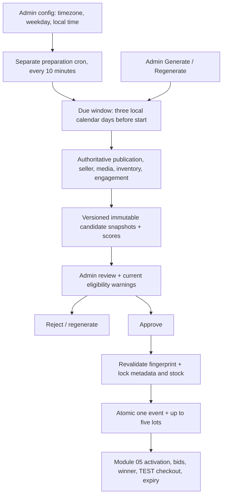

# Module 06 — explainable weekly artwork selection

Status: local implementation, not deployed. The pending Module 05 integration/privacy migration must precede `20261023142417_weekly_artwork_selection.sql`. No hosted users, data, cron, Storage, publications or functions were changed during implementation.

## Purpose and architecture

ArtVault recommends up to five genuinely available artworks for one weekly auction. Recommendation, admin approval and auction scheduling are separate operations. The current engine uses **Heuristic ranking**, not visual AI: it measures listing evidence and marketplace activity. No external model or paid provider runs automatically.



## Existing functionality reused

Supabase Auth UUIDs and protected database roles remain authoritative. The existing `artwork_analyses` table stores supported findings. Existing artwork, category, tag, image, Storage metadata, inventory, likes and wishlist records provide evidence. Existing signed-image delivery, Tailwind/shared UI controls and Admin Auctions page are reused. No duplicate admin dashboard, auction engine, inventory system or payment system was added.

Module 05 creates an event per legacy scheduling call. Module 06 instead inserts **one auction event and all selected lots in one database transaction**. Public cards use `/auctions/:eventId?lot=:lotId`; detail lookup matches both identifiers, and the weekly lot navigation prevents every card resolving to the first lot. Older event-only URLs continue to open the first lot.

## Eligibility

All checks run inside PostgreSQL against trusted records. Quantity is one physical unit per lot.

- Artwork must be PUBLISHED, INR, and priced at least 100 paise.
- Seller must be APPROVED and the associated account ACTIVE.
- Available stock must be at least one; reserved units are unavailable.
- At least one JPEG/PNG/WebP image must have a valid source SHA-256 and a matching private Storage object metadata row.
- No OPEN lot in a SCHEDULED/LIVE event or unresolved WINNER_PENDING lot may already commit the artwork.
- Draft, submitted, rejected, suspended, sold-out, missing-media or conflicting listings are excluded with reason codes.

The image check proves trusted metadata/object association, not visual quality or a fresh download of every object's bytes. Existing upload and private Storage protections remain responsible for media integrity. No physical inventory is modified and no checkout reservation is created during generation, ranking, approval or scheduling.

## Scoring, determinism and limitations

`metadata-v1` produces a ranking score, **not an objective artistic-quality score**.

| Component | Maximum | Rule |
|---|---:|---|
| Listing evidence | 40 | Title >=3 characters: 8; description >=40: 12; category: 5; valid image: 10; at least one tag: 5 |
| Unique engagement | 20 | `20*u/(u+5)`; union of distinct active users liking or wishlisting, excluding the seller |
| Freshness | 20 | Linear decay from 20 to zero over 60 days, clamped at both bounds |
| Exposure fairness | 15 | `15/(1 + previous non-cancelled auction appearances)` |
| Stock readiness | 5 | One available unit; more inventory does not buy a ranking advantage |

No views are invented. Likes plus wishlist by one user count once. Unique database constraints prevent repeat likes within each channel. Artist follows are not treated as artwork-specific evidence. Newly listed works receive freshness and unexposed-work credit; zero engagement is not automatic exclusion.

Ranking orders score descending, then creation timestamp ascending and artwork UUID. Selection takes one candidate per seller round, ordered by rank within each round, until five are chosen. This can select a lower-ranked work for diversity; the displayed rank and selection position remain distinct. With one seller, eligible works still fill the real available places. Shortages show the actual selected/eligible counts; no synthetic placeholders are created.

Each run stores its scoring version and captured reference time. Candidate snapshots, component values, eligibility reasons, explanations and SHA-256 fingerprints remain unchanged after generation. The same snapshot/reference time/version yields the same score and ordering. Fingerprints include relevant listing, seller, inventory, image, tag, engagement and exposure evidence. Description previews are bounded with a full-text hash; only a bounded tag preview and full tag hash are retained.

## Analysis and provider boundary

Eligible works receive an idempotent metadata fallback in `artwork_analyses`, labeled provider `HEURISTIC`, model/version `metadata-v1`, status FALLBACK and reason PROVIDER_NOT_CONFIGURED. Subjective style, composition, emotion and artistic scores remain absent. Existing non-heuristic results are never overwritten. Previously stored VISION findings may be shown for admin review only when their source image hash still matches; they are not converted into arbitrary artistic-quality points.

`scripts/lib/artwork-analysis-provider.mjs` is a server-only, injectable provider contract with strict Zod output validation, bounded metadata, at most an 8 MiB image, a 10-second maximum timeout, and at most one retry. It supplies no database tools, arbitrary URLs or secrets to a model. Listing text is untrusted data; returned action/SQL fields are rejected. Failures return safe reason codes without logging raw provider errors or prompts. A model may report image findings only when a configured vision adapter actually receives image bytes. Tests use explicitly named mocks; they are not evidence of real model execution.

The SQL worker works completely without this optional provider. No real provider adapter, credentials, external endpoint, billing plan or image inference is configured. Selecting and integrating one is an explicit future provider decision; the current module does not pretend the contract itself is a live model service.

## Database and authorization

One additive migration extends safe analysis metadata and creates four private tables:

- `weekly_selection_config`: one protected schedule and budget configuration.
- `auction_selection_windows`: unique UTC auction start, civil-time preparation deadline and eventual event link.
- `auction_selection_runs`: versioned generations, method/version, status, actors, review and safe failure codes.
- `auction_selection_candidates`: unique per-run artwork snapshots, fingerprints, components, rank and optional selected position.

UUID primary keys, foreign keys, checks, unique constraints and indexes protect relations and idempotency. Every new table has RLS and no browser/service-role table grants. Admin access occurs only through explicitly granted RPCs that verify protected ADMIN/SUPER_ADMIN membership and use fixed search paths. Customers, sellers and anonymous users cannot read internal scoring or invoke preparation/review/scheduling.

Candidates keep an immutable source UUID and snapshot, with a nullable foreign
key to the current artwork. Existing draft deletion remains supported: the link
becomes null and history is retained. If a selected work is removed,
ARTWORK_MISSING prevents approval or scheduling. Regeneration uses only surviving records. Already scheduled lots
retain the existing Module 05 deletion restrictions.

Public analysis fields contain no prompts, OTPs, passwords, provider errors, credentials or private engagement-user identifiers. Internal candidates are never added to Realtime or exposed as permissive Data API tables. Module 05's sanitized signals and owner-only order access remain unchanged.

## Weekly scheduling and concurrency

Initial timezone is Asia/Kolkata; default proposed weekly time is Sunday 18:00. **Configuration starts disabled** until an admin confirms the intended schedule. The separate `artvault-prepare-weekly-selection` job checks every ten minutes. It prepares due future windows three local calendar days before start (DST-aware for other configured timezones) and catches up while the event is still in the future. It never automatically approves, schedules, publishes artwork or starts payment.

Unique start/generation keys and an advisory lock serialize logical preparation. Duplicate requests recover the active run. Manual regeneration supersedes the old version while preserving history; APPROVED runs must be rejected before regeneration. Unexpected generation errors roll back all candidate/analysis writes, leave a FAILED run with a safe code, and get at most three versioned automatic attempts. CANDIDATE_LIMIT failures require admin intervention. Default scan limit is 250 artworks, configurable from 5 to 1000. Exceeding it fails visibly instead of silently dropping candidates.

Atomic weekly scheduling and the legacy single-lot scheduler share an advisory gate. The original single-lot implementation is moved to a protected private helper and kept behind the same public signature. The weekly path takes metadata/image/Storage SHARE locks and sorted inventory locks, then validates fingerprints again. It never locks an existing auction/lot row and never calls the single-lot scheduler five times. Pricing defaults to each authoritative stored listing price with a 5% increment rounded up (minimum 100 paise); there is no AI-generated valuation. Idempotent scheduling returns the same event.

Revalidation rejects changes instead of silently swapping approved works. Scheduled lots remain committed; later inventory/moderation changes use the existing Module 05 safeguards and admin cancellation/review process. Stock is reserved at winner checkout, not held throughout an auction; availability can change before winner checkout, which must fail safely rather than oversell. Refund or restock automation is not added.

## Admin workflow and recovery

Open Admin Control Center → Auctions → Review intelligent weekly selection. Configure the weekly timezone/day/time if desired. Generate a future selection, inspect thumbnails, artist/category, availability, ranking, components, supported findings and shortages. Refresh eligibility without mutating snapshots. Approve or reject with a reason; regenerate only when allowed. Scheduling requires a nonempty, approved and unchanged selection. History retains old versions and audit logs capture manual actions; system generations are recorded by their immutable run rows with a null requesting actor.

On staleness, reject and regenerate; do not change candidate rows or inventory by hand. On CANDIDATE_LIMIT, adjust the approved scan budget then regenerate. On repeated GENERATION_FAILED, inspect the local/hosted job diagnostics after deployment and repair the underlying cause before retrying. Never paste provider secrets into logs or chat.

## Environment and deployment

No new environment variable, package, Docker dependency, frontend secret or paid AI dependency is required for the fallback. Existing Supabase browser URL/publishable key and private-image delivery are reused. A future real provider must use server-only credentials and an approved adapter; never a VITE secret.

No hosted deployment was performed. Before eventual coordinated deployment: approve/review the pending Module 05 privacy migration first, then this Module 06 migration; inspect a linked dry-run; verify private-table grants, fixed-search-path RPCs, cron metadata and sanitized publication; deploy the matching multi-lot frontend. Confirm the desired business weekday/time and enable preparation explicitly. Do not reset, re-import or delete genuine data. No Edge Function deployment is required for the working SQL fallback.

## Verification and manual checklist

```powershell
npm.cmd run test:supabase
npm.cmd run test:scripts
npm.cmd run test:payments
npm.cmd test -- --run src/features/auction-selection src/features/auctions --pool=forks --maxWorkers=1 --fileParallelism=false
npm.cmd test -- --run --pool=forks --maxWorkers=1 --fileParallelism=false
npm.cmd run typecheck
npm.cmd run lint
npm.cmd run build
git diff --check
```

Tests use disposable PGlite fixtures and mocked Auth/RPC/Storage/Realtime/provider boundaries; they never write to hosted Supabase. PGlite executes real PostgreSQL constraints, RLS, RPCs and publication DDL but stubs cron registration because background-worker extensions are unavailable. Overlapping requests prove logical idempotency on its serialized backend; true multi-connection lock-contention testing, wall-clock cron delivery and live Realtime still require a local multi-backend PostgreSQL or approved hosted verification. Docker was not required or repaired.

Manual checks after deployment approval:

1. Confirm customer/seller/anonymous access denial; use a genuine authorized admin.
2. Set the weekly civil-time schedule and verify its UTC deadline three calendar days earlier.
3. Exercise eligible pools of zero, fewer than five, and more than five works; inspect diversity and explanations.
4. Inspect generation history, retry behavior, rejection and regeneration; confirm approval does not schedule.
5. Change stock, image, moderation or seller eligibility before scheduling; expect rejection and no partial event.
6. Schedule once and retry: verify one event and exactly the selected lots, with stock unchanged.
7. Open every lot card and switch between weekly lots; confirm distinct artwork, bid state and winner checkout target.
8. Verify Module 05 activation, two-bidder behavior, privacy, closure, winner-only checkout, one controlled Razorpay TEST payment and expiry safety.
9. Inspect real cron runs and sanitized WebSocket payloads. Never use live payments or mutate genuine records merely for tests.

## Final local verification — 2026-10-23

| Check | Final result |
|---|---|
| Full frontend, one fork worker, fixed source | 1,627 passed / 173 files; zero failed or skipped |
| Focused selection/auction/analysis/admin frontend | 130 passed / 19 files |
| PostgreSQL/RLS, including pending Module 05 and Module 06 | 145 passed; zero failed or skipped |
| Razorpay TEST handler/unit tests | 36 passed |
| Script/AR preparation and provider contract tests | 39 passed, including 6 new mocked provider tests |
| Typecheck | Passed |
| Production build | Passed |
| Lint | Zero errors; 66 existing warnings |
| Git diff check | Passed |

The first full attempt had an existing sign-in test timeout; its 17-test file
passed immediately in isolation. Another interim run overlapped an adapter
change and used a stale transformed schema. The final complete run used fixed
source files throughout and passed all 1,627 tests. No Auth source changes or
weakened assertions were used to resolve these interim failures. Existing jsdom
`scrollTo` notices remain non-fatal. Hosted and physical-device checks were not
executed or claimed as passing.

## Module 06 file manifest

Created:

- `supabase/migrations/20261023142417_weekly_artwork_selection.sql`
- `supabase/tests/weekly-selection.cases.mjs`
- `scripts/lib/artwork-analysis-provider.mjs`
- `scripts/lib/artwork-analysis-provider.test.mjs`
- `src/features/auction-selection/api/selectionRepository.ts`
- `src/features/auction-selection/api/selectionRepository.test.ts`
- `src/features/auction-selection/components/WeeklySelectionReview.tsx`
- `src/features/auction-selection/components/WeeklySelectionReview.test.tsx`
- `src/features/auction-selection/testFixtures.ts`
- `docs/MODULE06_WEEKLY_SELECTION.md`

Modified during this continuation (existing partial work retained):

- `ARTVAULT_PROJECT_STATE.md`
- `supabase/tests/foundation.test.mjs`
- `src/features/admin/components/AdminAuctionsView.tsx`
- `src/features/admin/components/AdminAuctionsView.test.tsx`
- `src/features/artwork-analysis/types.ts`
- `src/features/artwork-analysis/api/artworkAnalysisRepository.ts`
- `src/features/artwork-analysis/api/artworkAnalysisRepository.test.ts`
- `src/app/routes/ArtworkAnalysisPage.tsx`
- `src/app/routes/ArtworkAnalysisPage.test.tsx`
- `src/features/auctions/api/auctionsRepository.ts`
- `src/features/auctions/api/auctionsRepository.test.ts`
- `src/features/auctions/hooks/useAuction.ts`
- `src/features/auctions/hooks/useAuction.test.ts`
- `src/features/auctions/components/AuctionCard.tsx`
- `src/features/auctions/components/AuctionCard.test.tsx`
- `src/features/auctions/components/SellerAuctionLots.tsx`
- `src/app/routes/AuctionsPage.tsx`
- `src/app/routes/AuctionDetailPage.tsx`
- `src/app/routes/AuctionDetailPage.test.tsx`

Other files shown by Git status belong to the pre-existing Auth/Module 05 work;
they are not new Module 06 edits. No previous migration file was changed in
this continuation. Ignored local test logs are not deployment artifacts.
